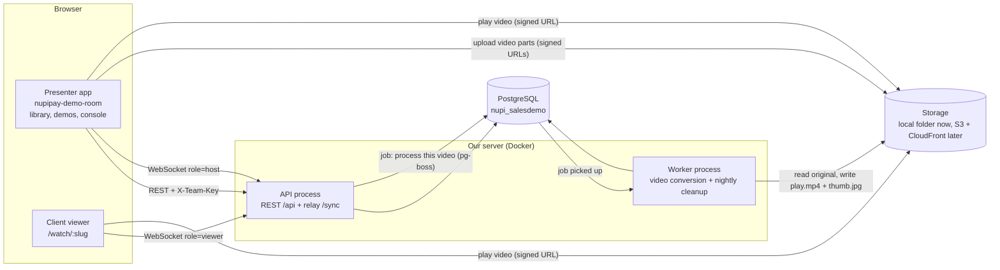
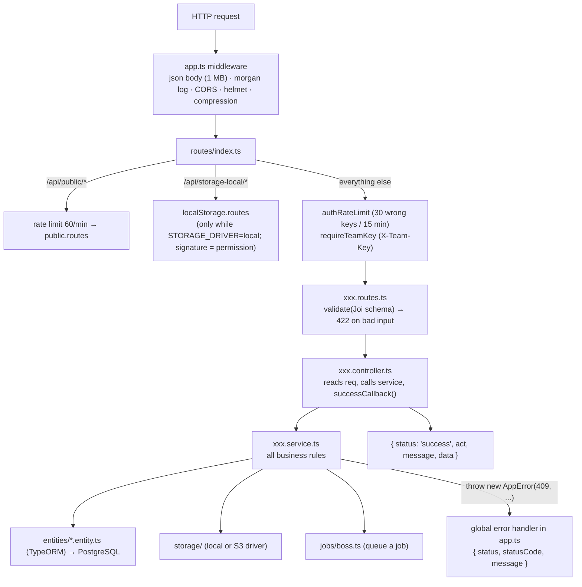
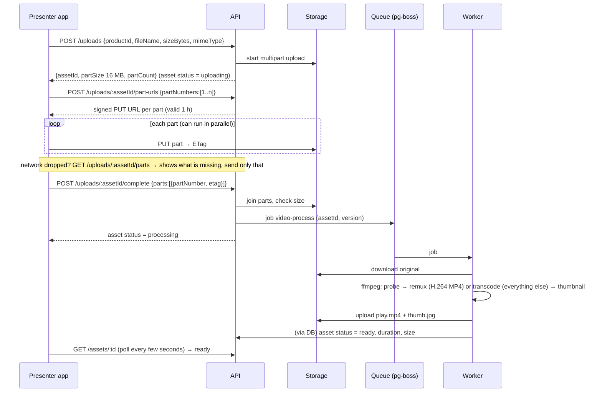
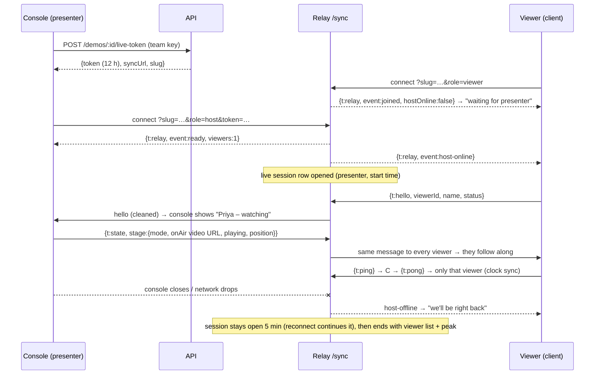

# Sales Demo Room backend: how it works

This explains the backend in plain words. It covers what each part does, how a request moves through the code, how to run it on your laptop, and how each feature works from start to finish.

Related documents:
- [DEPLOYMENT.md](DEPLOYMENT.md): putting it on the QA / production server (for DevOps)
- [AWS_REQUEST.md](AWS_REQUEST.md): the S3 / CloudFront / IAM changes requested from DevOps
- Swagger: `http://localhost:8130/api-docs` when the API is running (every endpoint, try it out)

---

## 1. The big picture



**Two processes from the same code:**

| Process | Command | Does |
|---|---|---|
| **API** | `node build/index.js` | Answers every request from the app, hands out signed upload/playback links, and runs the live relay (`/sync`) |
| **Worker** | `node build/worker.js` | Heavy background work: converts uploaded videos, makes thumbnails, and runs the nightly cleanup at 02:00 IST |

They are separate so that a 10-minute video conversion never slows down the API or a live demo. They don't talk to each other directly. The API puts a job in a queue stored in PostgreSQL (**pg-boss**), and the worker picks it up. If the worker is down, jobs wait and nothing is lost.

**Video files never pass through the API.** The browser uploads the file straight to storage, in 16 MB parts, using short-lived signed links the API gives out. Playback works the same way. This keeps the server light and lets uploads resume after a network drop.

---

## 2. Words used in this document

| Word | Meaning |
|---|---|
| **Product** | A product line in the library, e.g. UPI or Cards. It has a colour and talking points. |
| **Asset** | One video in a product (later also PPT decks). |
| **Run of show** | The ordered list of products and videos a demo will show, each switchable on or off. |
| **Client demo** | A demo prepared for one customer. It has a date and a unique **slug**, which is the client's link `/watch/<slug>`. |
| **Standard Flow** | A reusable demo template (`IsTemplate = true`). It has no client and no link. |
| **Console** | The presenter's live control screen (`/demos/:id/live`). It is the "host". |
| **Viewer** | The client's watch page. Viewers follow whatever the console shows. |
| **Relay** | Our WebSocket server at `/sync` that passes messages between the console and viewers. It replaces the free PeerJS service. |
| **Team key** | The shared password the presenter app sends in `X-Team-Key`. There is no login yet. |
| **Host token** | A short-lived pass (JWT) that proves a console may control one specific demo. |
| **Signed URL** | A link with an expiry time and signature, so only people we gave it to can upload or watch. |
| **ffmpeg** | An open-source program that reads and converts video files. The worker uses it. |
| **Remux / transcode** | Remux rearranges a video file without changing the picture: seconds, no quality loss. Transcode re-encodes it into another format: minutes. |
| **Fast start** | Moving the MP4 index to the front of the file, so playback begins immediately instead of after the whole file downloads. |

---

## 3. Code flow: how a request moves through the code

The structure is the same as be-admin-portal: **route → (validation) → controller → service → entity/DB**.



### Folder map

| Folder | What lives there |
|---|---|
| `src/index.ts` | Starts the API: checks settings, connects to the DB, warns about pending migrations, starts the queue (send-only), attaches the relay, listens. Shuts down cleanly on stop. |
| `src/worker.ts` | Starts the worker: video jobs and the nightly cleanup schedule. |
| `src/app.ts` | Express setup, Swagger at `/api-docs`, `/health`, 404, global error handler. |
| `src/configs/` | `env.ts` (every setting, with defaults) and `database.ts` (TypeORM connection, migrations table `T_SDR_Migrations`). |
| `src/routes/` | URL → validator → controller. `index.ts` decides what needs the team key. |
| `src/validators/` | Joi schemas. They also generate the Swagger request bodies. |
| `src/controllers/` | Thin: take the request, call a service, send the response. |
| `src/services/` | The real logic: library, products, assets, uploads, video processing, demos and flows, playback links, maintenance. |
| `src/entities/` | Table mappings (`T_SDR_*`). |
| `src/migrations/` | Reviewed SQL that creates or changes tables (`synchronize` is always off). |
| `src/storage/` | One interface with two drivers: `local` (folder on disk, now) and `s3` (later). Services never know which one is used. |
| `src/jobs/` | pg-boss queues: `video-process`, `maintenance-cleanup`. |
| `src/sync/` | Live relay (`relay.ts`), host tokens, live session history. |
| `src/utils/` | AppError, logger, ffmpeg wrapper, small helpers. |
| `src/docs/` | OpenAPI (Swagger) document, generated from the validators. |
| `test/` | Automated tests (`npm test`). They need no database. |

### Database tables (all prefixed `T_SDR_`, database `nupi_salesdemo`)

| Table | Holds |
|---|---|
| `T_SDR_Workspace_Settings` | One row: company About text + 3 highlights |
| `T_SDR_Products` | Products. Archived, not deleted. |
| `T_SDR_Assets` | Videos: status, current version, size, duration, and the upload in progress (`PendingUpload`) |
| `T_SDR_Demos` | Client demos **and** Standard Flows (`IsTemplate`). The run of show is stored as JSON. |
| `T_SDR_Demo_Sessions` | Each live session: presenter, start/end, viewers by name, peak count |

pg-boss keeps its own tables in the `pgboss` schema of the same database. It creates them itself.

---

## 4. Local flow: running it on your laptop

You need Node.js 20 or newer and PostgreSQL. ffmpeg comes with `npm install`, so there's nothing extra to install.

```bash
npm install
cp .env.example .env        # then fill in TEAM_KEY, HOST_TOKEN_SECRET and the DB_* values
#   TEAM_KEY:          at least 16 characters (the presenter app sends it)
#   HOST_TOKEN_SECRET: at least 32 random characters
npm run migration:run       # creates the T_SDR_* tables (one time, and after new migrations)

npm run dev                 # terminal 1: API on http://localhost:8130
npm run dev:worker          # terminal 2: worker (needed for uploads to become playable)
```

Check that it works:

| Check | Expect |
|---|---|
| `http://localhost:8130/health` | `{"status":"UP"}` |
| `http://localhost:8130/api-docs` | Swagger. Click **Authorize** and paste the team key to try the endpoints. |
| `npm test` | All tests pass (no DB needed) |
| `npm run cleanup:now` | Runs the nightly cleanup once |

Local storage: uploaded files go to `./storage/` and are served through signed links at `/api/storage-local/...`. When DevOps sets up S3, switch `STORAGE_DRIVER=s3` and nothing else changes for the app.

---

## 5. Feature flows

### 5.1 Startup: the presenter app opens

1. The app calls `GET /api/bootstrap` with `X-Team-Key`.
2. One response returns everything: settings, products, assets (each with `status`, `playable` and a thumbnail link), and Standard Flows.
3. `GET /api/demos?page=1&take=20` lists client demos.

### 5.2 Uploading a video (resumable, direct to storage)



**Rules:**
- Only MP4, MOV, WebM and M4V up to 2 GB are accepted. Anything else is refused before a byte is sent.
- The worker retries twice on temporary errors. A file that isn't a real video fails at once with a clear message.
- **Replacing a video** (`POST /assets/:id/replace-upload`) runs the same flow. The old version keeps playing until the new one is ready, and if the new one fails, the old one stays.
- **Cancel:** `DELETE /uploads/:assetId`.

**Why the conversion?**

| Problem | Fix |
|---|---|
| iPhone videos (HEVC/MOV) and screen-recorder WebM files don't play in every browser | Convert to H.264 + AAC MP4, which plays everywhere |
| Many MP4s keep their index at the end, so playback waits for the whole file | Fast start puts the index at the front |
| 4K or 1440p recordings waste bandwidth during a demo | Shrink to at most 1080p (the shorter side, so portrait phone videos keep their quality) |
| The library needs previews | Generate a thumbnail |

A normal H.264 MP4 up to 1080p is only remuxed: about 1 second, no quality loss. Bigger ones are converted down to 1080p.

### 5.3 Playing a video

1. `GET /api/assets/:id/playback-url` returns `{ url, expiresAt, durationSec, width, height, thumbnailUrl }`.
2. The URL is signed and valid for 4 hours, longer than any demo. The app puts it in the `<video>` element.
3. If the asset is still processing or failed, the API answers 409 with a clear message.

The console sends this URL to viewers inside the live state, so clients play the same file.

### 5.4 Library management

| What | How |
|---|---|
| Products | Create, edit, reorder, archive and restore (names are stored in capitals; duplicates → 409). |
| Assets | Edit, move to another product, reorder. Delete moves them to Trash, and the response lists the demos and flows that use them. Restore brings them back. |
| Trash | `GET /api/trash`. Items are purged for good after 30 days by the nightly cleanup. |

### 5.5 Client demos and Standard Flows

| Step | Endpoint | Result |
|---|---|---|
| Create a demo | `POST /demos {name, clientName, date[, flowId]}` | A slug like `2026-11-24-acme-retail-product-walkthrough-k7f2`, which is the client's link. Without a flow, the whole library is enabled. |
| Edit | `PATCH /demos/:id` | Run of show, welcome screen, options. Changing the date keeps the link. |
| Copy | `POST /demos/:id/duplicate` | New demo with a new link |
| Save as template | `POST /demos/:id/save-as-flow` | New Standard Flow |
| Demo from a template | `POST /flows/:id/demos` | New client demo |
| Delete / restore | `DELETE` / `POST .../restore` | A deleted demo's link stops working at once |

### 5.6 Live demo (console ↔ relay ↔ viewers)



**Safety rules in the relay:**
- Only the console (valid host token for that demo) can send `state`. Viewers can only send `hello` and `ping`, and only for themselves.
- One console per demo. A second console gets `taken` (code 4009) unless it asks for `takeover=1`, in which case the old one gets `replaced` (4010).
- At most 50 viewers per demo (4003). Messages are capped at 64 KB, and a flooding viewer is throttled to 20 messages/s.
- Only our frontend's website can connect from a browser (Origin check). Dead connections are dropped by a 30 s heartbeat.
- Deleted or unknown demo → 4004. After a server restart, clients reconnect and old sessions are closed on startup.

Session history: `GET /api/demos/:id/sessions` shows presenter, start and end, viewers by name, and peak.

### 5.7 Nightly cleanup (worker, 02:00 IST)

1. Cancels uploads unfinished for 24 h. An upload of a brand-new video is removed entirely.
2. Re-queues videos stuck in "processing" for more than 60 min.
3. Purges Trash items older than 30 days, including their files.
4. Removes leftover upload folders (local storage).

Run it by hand with `npm run cleanup:now`.

---

## 6. Errors and responses

| Situation | HTTP | Body |
|---|---|---|
| Success | 200 | `{ status: "success", act, message, data }` |
| Broken JSON | 400 | `{ status: "fail", statusCode, message }` |
| Missing or wrong team key | 401 | " |
| Signed link expired or tampered | 403 | " |
| Not found | 404 | " |
| Conflict (duplicate name, video not ready, demo already live elsewhere) | 409 | " |
| Validation | 422 | Message names the field |
| Too many requests | 429 | " |
| Server error | 500 | Details hidden in production; see `logs/error-*.log` |

---

## 7. What is not built yet

| Item | Status |
|---|---|
| S3 + CloudFront storage driver | Waiting for DevOps to apply [AWS_REQUEST.md](AWS_REQUEST.md) |
| Frontend integration | API client with the team key, upload UI, switching from PeerJS to `/sync`, Flows and Trash screens, removing the browser-side S3 keys |
| Phase 2: PPT | PPTX → PDF → slide images, shown as a synced `deck` stage |
| Phase 3: transcription | English and Hindi, for Teams and Google Meet. Fireflies pilot decision pending. |
| Real-network test of the relay | Corporate Wi-Fi, mobile hotspot, home broadband, once deployed on QA |
